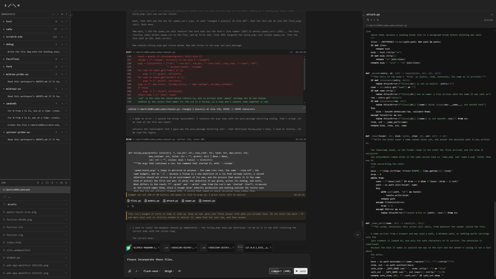

#  S   ╱─╲   H  (W) •  Smol Agentic Harness's WebUI 

[](https://www.python.org/)
[](LICENSE)


[](https://github.com/FrischCode/smol-agentic-harness)

SAHW is **[SAH's](https://github.com/FrischCode/smol-agentic-harness) companion web UI**: a stdlib-only Python server serving a **fully featured** static frontend,
reading [SAH's](https://github.com/FrischCode/smol-agentic-harness) run logs. Living experiment as proof of [SAH's](https://github.com/FrischCode/smol-agentic-harness) viability.

> [!NOTE]
> SAHW is a *companion* for [S   ╱─╲   H  •  Smol Agentic Harness](https://github.com/FrischCode/smol-agentic-harness) and needs an instance of it to function and *was actually written using SAH itself*. 

## Screenshot

<details><summary>Click to enlarge screenshot</summary>
<a href="screenshot.png">
  
</a>
</details>
<a href="screenshot.png">
  
</a>

## Contents

- [Quickstart](#quickstart)
- [The front door (`sahw.bat` / `sahw.sh`)](#the-front-door-sahwbat--sahwsh)
- [The machine's own config (`.env`)](#the-machines-own-config-env)
- [What the server does](#what-the-server-does)
- [What a run leaves behind](#what-a-run-leaves-behind)
- [How it works](#how-it-works)
- [Testing](#testing)
- [Credits](#credits)

## Quickstart

The tree is self-contained: a copy of it is the same product on another machine, the venv being a
copyable directory. It needs [SAH — smol-agentic-harness](https://github.com/FrischCode/smol-agentic-harness)
standing somewhere on the machine, because it lists the runs SAH writes and spawns new ones from
the SAH tree:

```bat
rem 1. get SAH, somewhere stable:
git clone https://github.com/FrischCode/smol-agentic-harness C:\Work\SAH
rem    and set it up the way its README's quickstart does — its own venv included,
rem    because a spawn runs on the SAH tree's own interpreter.

rem 2. get this tree, and give it an interpreter (any Python >= 3.11; uv's venv is a copyable
rem    directory — the core is stdlib-only, so nothing else needs installing to run it):
uv venv .venv

rem 3. point the launcher at SAH — the one line to edit in sahw.bat / sahw.sh:
set "SAH_INSTALL_DIR=C:\Work\SAH"

rem 4. start the server; it opens the page it answers on (http://127.0.0.1:8321):
sahw.bat
```

`python -m sahw` is the whole server and every flag (`--host --port --runs-root --sah-tree
--no-open`); the launcher is the thin wrapper that finds SAH for you. The server listens on
loopback only: it holds no auth, and a workspace browser on a reachable interface would be a share
of the machine.

## The front door (`sahw.bat` / `sahw.sh`)

The launcher finds the SAH tree before it starts the server, in this order:

1. **`SAH_INSTALL_DIR`** — the one line at the top of the file. A placeholder ships with the tree;
   point it at wherever SAH stands on this machine.
2. **`sah` on the `PATH`** — if that directory is not there, the launcher resolves `sah` (the
   harness's own launcher) and takes the folder it stands in.
3. **neither** — the launcher prints the line that names the missing install and stops; the server
   does not start on a guess.

Extra arguments pass straight through (`sahw.bat --port 8391`), and the two paths it hands the
server are derived from the one place SAH stands: `--sah-tree` the tree, `--runs-root` the `runs`
folder inside it.

## The machine's own config (`.env`)

The tree ships its fallbacks; a gitignored `.env` at the tree root is where this machine states
its own (`.env.example` is the committed shape). The server reads it once at start and fills only
the variables it does not already have in the environment — a value the shell exports or a flag
names always wins over the file. The shipped fallbacks are generic: loopback, port 8321, and the
two SAH locations left silent — an API that lists and streams the logs it can read, and a spawn
that refuses with the flag that names it.

| key | the server reads it as |
|---|---|
| `SAHW_RUNS_ROOT` | the folder holding the run folders — what the UI lists |
| `SAHW_SAH_TREE` | the SAH tree a spawned run runs from — what the UI launches |
| `SAHW_PORT` | the port the UI answers on (shipped fallback: 8321) |
| `SAHW_NO_OPEN` | `1`: the open acts refuse with the line that names it — a headless box, or a verification that must not open windows |
| `SAHW_STREAM_POLL` | how often, in seconds, a followed run's log is asked whether it grew; the run's trace drains on the same look, so this is the pace the live pane fills (shipped default: 0.02) |

## What the server does

The page says the rest. Its regions are a workspace→run tree above a directory browser (what a
spawn starts in), the chat pane (a run's conversation as its log stands it), and the preview of
the files a run's edits touched. The server's own acts:

- **lists** — the run folders under the runs root, and the directory tree the operator browses to
  choose where a spawn stands;
- **streams** — the run it is shown: the steps as they land, the words as they arrive;
- **spawns** — a run: `python -m sah run` on the SAH tree's own venv interpreter, the package from
  source (`PYTHONPATH` the tree), with the workspace, the objective and the model's word the page
  names;
- **opens** — the folder and file acts on this machine through its own openers (refused outright
  when the server stands with `--no-open`).

The front is ES modules with no build step: `web/index.html` loads `web/assets/js/app.js` as a
module, and the entry imports the files the front is cut into. Nothing the page runs is answered
from outside this tree.

## What a run leaves behind

SAHW reads what SAH writes and writes nothing beside it: the run's folder (`log.jsonl`,
`report.md`, …) is the harness's, and its layout is documented in
[SAH's README](https://github.com/FrischCode/smol-agentic-harness#what-a-run-leaves-behind). The
one file the UI adds is the run's *current name* — `name.txt`, the operator's word beside the log
the run never touches: the record holds the boot's word, the UI holds the mutable one, and a
rename is safe on a working run because the run's process never opens the file.

## How it works

- **One truth, projected.** Everything the page shows is a projection of the run's log — the same
  discipline as the harness: the log is written once, by the harness, and the server is a reader of
  it.
- **The spawn is the harness's act.** A run the page starts is a `sah run` the operator's own
  launcher would assemble: the page supplies the task, the directory and the model's word, and the
  permissions the run gets come from the harness's flag discipline, never from the page.
- **Loopback is the boundary.** The server listens on `127.0.0.1` and holds no auth — the machine's
  own UI for the machine's own runs — and `--host` is the one door for the one run that means it.
- **A refusal is a word.** A route the server will not perform answers with the line that names
  the refusal — a spawn it cannot name, an open it was told not to open, a path it will not read —
  never a silence the page has to guess at.

## Testing

The suite stands under `tests/` and ships with the product: `python -m pytest`, hermetic — no real
spawns, no servers, no network, no machine config (`conftest.py` pins the env file at a path that
never exists and clears the ambient `SAHW_` values, so a default resolves the same way on every
box). One dev tool beyond the stdlib: `pip install pytest` into the venv. The config is in
`pyproject.toml`; contributor rules and the invariants are in `AGENTS.md`.

## 3rd Party Libraries:

[prism](https://github.com/prismjs/prism), [streaming-markdown](https://github.com/thetarnav/streaming-markdown), [DAUB](https://github.com/sliday/daub)

## Credits

Built on [SAH — Smol Agentic Harness](https://github.com/FrischCode/smol-agentic-harness), and
created, tested and inspired by using [pi](https://github.com/earendil-works/pi),
[Qwen 3.8 Flash Next](https://huggingface.co/Qwen/Qwen3.8-Flash-Next) &
[Qwen 3.8 27B](https://huggingface.co/Qwen/Qwen3.8-27B)

<sup>Jan - C. Frischmuth • 2026</sup>
